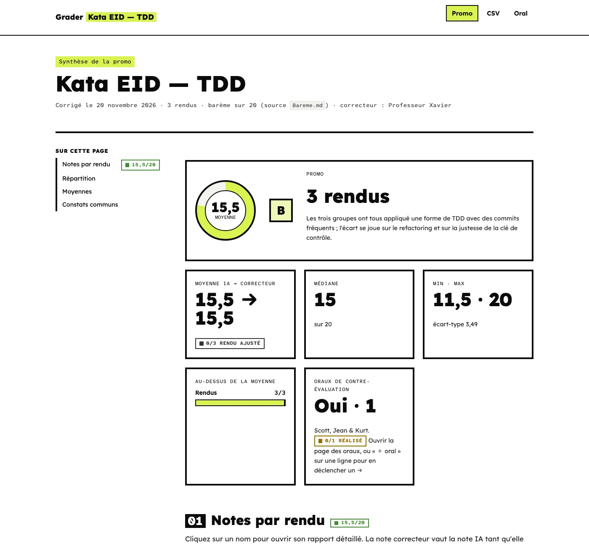
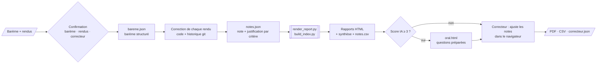
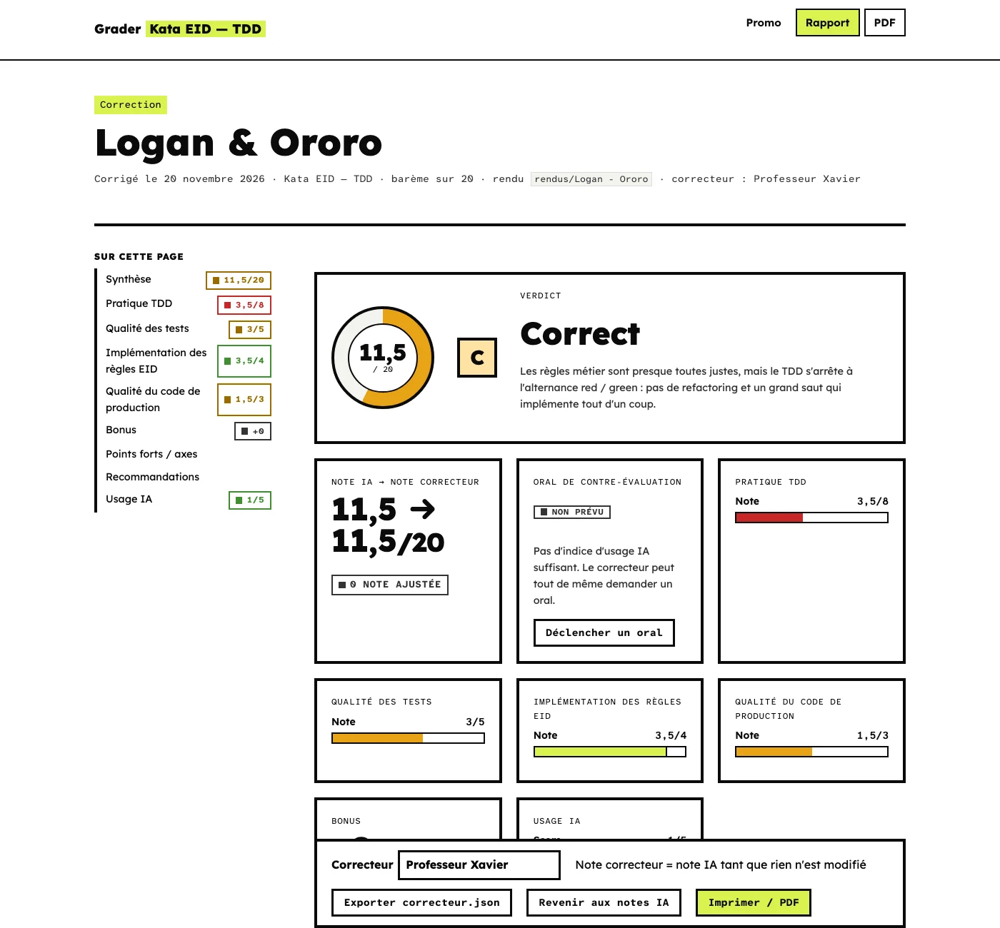
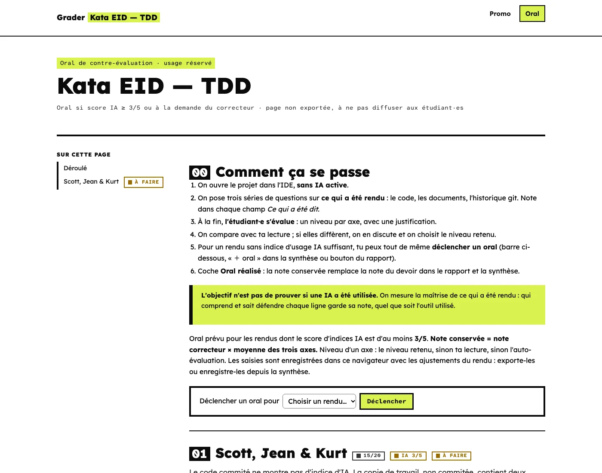

# Grader


Skill Claude Code qui corrige des rendus étudiants à partir d'un **énoncé / barème** (Markdown, PDF, Word ou texte) et produit des rapports HTML que le correcteur relit et ajuste dans son navigateur.



## Features

- **Notation critère par critère** avec preuves (fichier, ligne, commit git)
- **Rapport HTML par rendu** : cadran de note, grade A→F, jauges par partie, extraits de code colorés, constats, recommandations
- **Synthèse de promo** : moyenne, médiane, min / max, écart-type, répartition des grades, moyennes par critère, constats communs
- **Double note IA / correcteur** : ajustable dans le navigateur, commentaire facultatif, recalcul en direct
- **Indices d'usage IA** (score 1→5) et **oral de contre-évaluation** qui compense la note
- **Calculs faits par les scripts**, jamais par le LLM : totaux, bonus, malus, plafonnement, note ramenée (ex. /100 → /20)
- **Exports** : `notes.csv` (Excel), PDF depuis le navigateur, `ajustements.json`
- **Lecture seule** : le code des rendus n'est ni compilé, ni exécuté, ni modifié

## Process



## Installation

```bash
mkdir -p ~/.claude/skills/grader
cp -R SKILL.md assets scripts ~/.claude/skills/grader/
```

Prérequis : `python3` (bibliothèque standard) et un navigateur.

## Utilisation

Depuis le dossier qui contient le barème et les rendus :

```
/grader                 # ou : « corrige les rendus avec ce barème »
/grader ./Bareme.md     # chemin explicite
```

```
M1 - EADL/
├── Bareme.md                      ← énoncé + barème
├── correction/                    ← produit
│   ├── index.html                 ← synthèse de promo (point d'entrée)
│   ├── notes.csv · bareme.json · synthese.json
│   └── oral.html · oral.json      ← oraux de contre-évaluation
└── rendus/
    ├── Logan - Ororo/             ← un dossier (souvent un dépôt git) par rendu
    │   └── correction/            ← produit
    │       ├── index.html         ← rapport détaillé
    │       ├── notes.json         ← notes IA + justifications
    │       ├── correcteur.json    ← ajustements (au premier ajustement)
    │       └── totaux.json
    ├── Scott - Jean - Kurt/
    └── Remy - Hank/
```

## Rapport d'un rendu



- Chaque critère affiche la **note IA** et un champ **note correcteur** (égale par défaut)
- Un **commentaire** apparaît dès que les deux notes diffèrent
- Totaux, grade et jauges recalculés en direct, état sauvegardé dans le navigateur
- Barre du bas : nom du correcteur, export `correcteur.json`, retour aux notes IA, impression / PDF

## Synthèse de promo

- Notes IA, notes correcteur et écart, mis à jour dès qu'un rapport est ajusté
- **Exporter ajustements.json** / **Importer…** pour changer de poste ou de navigateur
- **Enregistrer dans « dossier »** (Chrome, Edge) : écrit `correcteur.json` dans chaque rendu
- **Exporter les PDF** : imprime chaque rapport à tour de rôle (un clic par rapport)
- Section facultative « meilleurs exemples » via `correction/exemples.md`

> L'enregistrement automatique reste local au navigateur : exportez ou enregistrez pour conserver vos ajustements, puis demandez à Claude de régénérer la synthèse pour mettre à jour `notes.csv`.

## Oral de contre-évaluation

Un rendu peut être juste sans que son auteur·e le comprenne, par exemple s'il a été généré par une IA. L'oral de contre-évaluation sert à vérifier que l'étudiant·e **maîtrise ce qu'il ou elle a rendu**. Il ne cherche pas à prouver qu'une IA a été utilisée : celui ou celle qui sait expliquer et défendre son code garde sa note, quel que soit l'outil utilisé.

**Déroulé** (individuel même pour un binôme, IDE ouvert **sans IA active**) :

1. **Questions sur le code rendu**, préparées par Claude à partir des fichiers, des lignes et des commits du rendu, réparties sur trois axes :
   - **Vocabulaire** : expliquer les termes et concepts qu'il ou elle a écrits
   - **Démarche** : raconter l'ordre réel du travail, confronté à l'historique git
   - **Consignes** : montrer où le rendu répond à l'énoncé
2. **Exercice en direct** (environ 5 min) sur son propre code, souvent : écrire le test qui met en évidence un bug qu'il ou elle a signalé.
3. **Auto-évaluation** : l'étudiant·e se positionne sur chaque axe et justifie son choix.
4. **Confrontation** : le correcteur compare avec sa propre lecture. Si elles diffèrent, on en discute et on retient un niveau.

**Effet sur la note** : chaque axe vaut *Maîtrise* (100 %), *L'essentiel* (75 %), *Hésite* (50 %) ou *Ne sait pas* (0 %).

> **Note conservée = note correcteur × moyenne des trois axes**
> Exemple : 16/20 avec Maîtrise, L'essentiel, Hésite → 16 × 75 % = **12/20**



- **Prévu** automatiquement si le score d'indices IA est **≥ 3/5**
- **Déclenchable** par le correcteur pour n'importe quel rendu (rapport, synthèse ou page des oraux)
- Chaque question est fournie avec la **réponse attendue** et le **signal d'alerte** qui doit faire baisser le niveau
- Saisie dans `oral.html` pendant l'oral ; une fois l'oral coché « réalisé », la note conservée remplace la note dans le rapport, la synthèse, les PDF et `notes.csv`
- `oral.html` est réservée au formateur : liée depuis la synthèse uniquement, jamais exportée

## Scripts

| Fichier | Rôle |
|---|---|
| `scripts/render_report.py` | `notes.json` → rapport HTML ; échoue si un critère manque, est inconnu ou hors bornes |
| `scripts/build_index.py` | synthèse de promo, `notes.csv`, `oral.html` |
| `scripts/oral.py` | page des oraux, appelée par `build_index.py` |
| `scripts/export_pdf.py` | facultatif : HTML → PDF A4 en lot via Chromium headless |
| `assets/grader.js` | ajustements dans le navigateur : recalcul, stockage local, export / import |

## Exemple

[`samples/x-men/`](samples/x-men/) : kata EID en TDD (barème sur 20), 3 rendus anonymisés. Point d'entrée : [`correction/index.html`](samples/x-men/correction/index.html).

| Rendu | Note | Grade |
|---|---|---|
| Logan & Ororo | 11,5/20 | C |
| Scott, Jean & Kurt | 15/20 | B |
| Remy & Hank | 20/20 | A |

Seules les sorties de correction sont incluses, pas le code des rendus.
